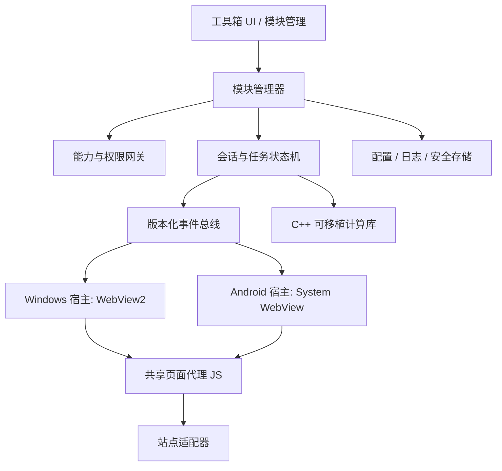

# Toolbox 完整架构草案

版本：0.1（2026-09-28）  
目标平台：Windows x64、Android arm64，后续按需求扩展。  
首个模块：当前学习通用户脚本的可移植化；工具箱本身不与该网站耦合。

## 1. 决策摘要

**采用平台原生浏览器容器、共享协议与模块内核。** Windows 用 WebView2，Android 用 Android WebView。两端都基于 Chromium 系列渲染技术，但宿主 API、登录数据、后台规则和调试入口不同。共享部分使用 TypeScript/JavaScript 页面代理；计算密集型、可批处理的部分才进入 C++17/20 库。不要自行维护 Chromium fork，也不要将桌面 WebView2 包装层误认为安卓运行时。

此决策优先满足稳定性和可移植性。UI 可以先分别实现；若工具箱大量通用页面需要共享 UI，后续可把工具箱 UI 做成响应式 Web 前端，分别由两个薄宿主承载。Tauri 2 可作为通用外壳候选，但需要先验证其移动端多 WebView、注入和帧控制能覆盖真实模块需求，不能仅凭“支持 Android”决定整个架构。

## 2. 目标与边界

目标：

1. 允许多个彼此独立的工具模块并存、按平台启停与升级。
2. 一个模块崩溃、卡住或遇到站点改版时，不拖垮工具箱主界面。
3. Windows 与 Android 共享业务协议、页面代理、站点适配规则及测试夹具。
4. 能记录可复现的结构化诊断，不依赖用户手工翻找控制台。
5. 敏感设置留在本机安全存储；第三方网页拿不到通用本机能力。
6. 通过实测决定 C++/SIMD 的使用范围，保留 x64 与 arm64 双平台构建路径。

边界：

- 免 root 的安卓应用可以控制**自己应用内**的 WebView；普通 WebView 不能接管外部 Chrome 或其他 App。
- Android 退到后台、锁屏后的页面运行与媒体行为受系统限制。工具箱应公布每个模块的前台要求，不能承诺与 Windows 相同的无人值守运行能力。
- WebView 不会让网站的 DOM、跨域限制或登录流程变得稳定。网页结构适配仍是独立工作。
- 当前项目的 `GM_*`、`unsafeWindow`、`@all-frames` 不能原封不动移入 WebView；它们属于油猴宿主契约。

## 3. 分层结构



| 层 | 职责 | 禁止事项 |
| --- | --- | --- |
| 工具箱外壳 | 导航、模块安装/启停、设置、诊断、更新 | 直接解析站点 DOM |
| 模块管理器 | 清单校验、版本和依赖、生命周期、能力分配 | 给模块默认开放文件/网络/密钥全权限 |
| 会话引擎 | 状态转换、取消、超时、幂等、恢复策略 | 在 UI 线程执行长任务 |
| 平台 WebView 宿主 | 创建/销毁会话、导航、帧事件、脚本注入、消息、DevTools | 把平台细节泄漏进共享模块 |
| 页面代理 | 采集 DOM 事实、执行经过授权的页面动作、上报事件 | 持有 API 密钥、文件系统能力或无限轮询 |
| 站点适配器 | 路径识别、选择器、页面状态与版本兼容 | 修改全局浏览器行为作为通用默认策略 |
| C++ 计算库 | 大批量文本/字体/图像处理等已测出瓶颈的纯计算 | 发起导航、接触 WebView 对象或保管密钥 |

## 4. 模块契约

每个模块具有 `module.json`，字段至少包括：`id`、`version`、`apiVersion`、`platforms`、`entry`、`allowedOrigins`、`capabilities`、`settingsSchema`、`migrations`、`minimumHostVersion`。模块 ID 与能力名称稳定且版本化。

首批能力建议：`web.session`、`web.dom.observe`、`web.dom.act`、`storage.module`、`network.scoped`、`notification`、`native.compute.font`。`network.scoped` 必须列明域名。每次宿主执行命令时再次检查模块、会话、来源和能力，不以 UI 开关代替权限验证。

生命周期：`install → validate → activate → openSession → run → suspend/resume → stop → deactivate`。模块状态与会话状态分开；一次会话失败不等于模块安装损坏。模块升级执行显式配置迁移，失败可回滚到上一版。

第一阶段只支持仓库内置模块与签名的工具箱版本更新。不要在 Android 上预设能任意下载并加载原生 `.so` 插件；后续扩展市场必须另做签名、审核、兼容性和分发设计。

建议代码仓结构（`apps` 可独立发布，`packages` 不依赖具体宿主）：

```text
apps/windows-host/       # Windows UI、WebView2、DPAPI/安装更新
apps/android-host/       # Android UI、WebView、Keystore/生命周期
packages/protocol/       # 消息 schema、兼容性和代码生成
packages/page-agent/     # 文档起始注入的共享 JS
packages/module-sdk/     # 模块契约、能力声明与测试工具
native/core/             # 可移植 C++、C ABI、JNI 包装
modules/chaoxing/        # 首个站点适配器与独立测试夹具
tests/fixtures/          # 脱敏网页与双端冒烟用例
```

宿主对模块公开的最小接口为 `openSession(options)`、`closeSession(id)`、`subscribe(id, event)`、`sendCommand(id, command)`、`storage.get/set(moduleId, key)` 和 `compute.run(capability, input)`。所有调用带超时与取消；`openSession` 返回的是不透明句柄，模块不直接持有 WebView 控件或文件路径。

## 5. WebView 与页面代理

### Windows

- WebView2 使用专属且持久的 User Data Folder。按用户/模块决定是否共享会话，不默认读取现有 Edge 配置。
- 在文档创建阶段注册页面代理；导航时建立新的 `sessionGeneration`，旧消息全部失效。
- 使用 WebView2 帧、导航、网络和 DevTools 诊断 API；生产构建默认关闭调试端口。
- WebView 进程异常退出时只重建受影响的会话，并保存最近事件与页面指纹。

### Android

- 使用 Android WebView 与 AndroidX WebKit 能力检测；支持时使用 document-start 注入与受限网页消息通道，不支持时采用明确的降级路径并记录诊断。
- Activity/进程重建后恢复工具箱状态；WebView 的页面与媒体运行状态按实际平台行为处理，不伪造持续运行成功。
- 导航严格限制预期 HTTPS 域名；外链交系统浏览器或明确的隔离会话。
- 页面脚本不直接接触 Android 文件、通知、密钥或任意原生方法。

### 共享页面代理

页面代理是短生命周期 JS 包。它只把 `DOCUMENT_READY`、`VIDEO_FOUND` 等页面事实送到会话引擎，并执行有 `requestId` 与截止时间的命令。每个 iframe 单独注入、单独标识，不尝试从顶层脚本跨域读取子帧 DOM。站点适配器独立维护选择器，并为每一版真实页面保留脱敏夹具。

## 6. 事件与命令协议

控制通道先用有上限的 JSON；大图/大块数据走单独二进制传输，避免反复 Base64 与跨语言复制。消息信封：

```json
{
  "protocol": 1,
  "moduleId": "example.web-module",
  "sessionId": "uuid",
  "generation": 4,
  "frameId": "main",
  "seq": 17,
  "requestId": "uuid-or-null",
  "type": "VIDEO_FOUND",
  "payload": { "selectorVersion": 2 }
}
```

宿主先验证消息长度、协议版本、来源、模块/会话归属、`generation`、递增序号与 payload schema。重复序号按幂等规则忽略；未知版本拒收并给出可读错误。一个请求只产生一次终态响应，取消之后迟到的结果不改变状态。日志事件可丢弃/采样，命令结果不可静默丢失。

## 7. 状态、存储、密钥

- 每个 Web 会话使用显式状态机，如 `CREATED → PAGE_READY → OBSERVING → COMPLETE`，另有 `PAUSED`、`FAILED`、`CANCELLED`。动作要由状态转换产生，而不是多个定时器各自点击页面。
- 配置与任务元数据使用 SQLite，启用 WAL 和版本迁移；结构化日志按大小与天数轮转。WebView Cookie 留在平台专属 Profile，不复制到普通配置文件。
- Windows 密钥使用系统凭据保护能力，Android 使用 Keystore 支持的密钥包装；UI 和页面代理只获得必要的短时结果，不读取原始密钥。
- 诊断导出默认脱敏 URL 参数、Token、Cookie、题目内容和用户身份信息；用户可单独选择扩展诊断范围。

## 8. 安全与隔离

第三方网页按不可信内容处理。页面脚本不能调用“任意文件读写”“任意 HTTP 请求”“执行命令”等通用桥接方法；只暴露窄命令，并由宿主检查消息来源和模块授权。模块 UI 与第三方网页采用独立 WebView/进程边界，避免网页脚本拿到工具箱 UI 的权限。桌面模块需要更强隔离时采用独立辅助进程；Android 首期只执行随应用构建、经过审核的模块。

站点适配器失效应进入可观察的 `UNSUPPORTED_PAGE` 状态，不能继续尝试模糊点击。密钥不写入用户脚本、日志或模块包。

## 9. 性能策略：先减少工作，再优化 CPU

第一优先级：减少 DOM 全树扫描、事件去抖、按页面角色订阅、避免高频跨 WebView/JNI 往返、批量传输结果。渲染和网络等待通常比小段 JS 算术昂贵。

C++ 库只承载可独立测量的大批量纯计算，例如现有脚本的字体映射解析、图像预处理或大量文本规则匹配。使用稳定 C ABI（Windows DLL）与 JNI（Android `.so`）封装，严格规定所有权、错误码、线程与最大输入大小。先写可移植标量实现和一致性测试；仅当 profiler 显示实际收益，再加 x64 AVX2 / arm64 NEON intrinsics，保留运行时特性检测与标量回退。手写汇编是最后选择，需同时承担架构、ABI、编译器和安全维护成本。

建议验收指标（在真实设备上建立基线后再锁定数值）：UI 交互不卡顿、会话异常不会拖垮工具箱、消息处理 p95、冷启动、内存峰值和电量消耗均有自动记录。优化提交必须带基准数据和正确性回归。

## 10. 调试、质量与发布

- 统一 Trace ID：一次会话的导航、帧、页面代理、状态机、原生计算记录同一个 `sessionId`。
- 测试金字塔：纯状态机/协议测试 → 脱敏 DOM 夹具浏览器测试 → Windows WebView2 集成 → Android 真机/模拟器集成 → 少量真实站点冒烟。
- Windows 用 WebView2 DevTools/CDP 捕获帧与网络事件；Android 调试构建开启 WebView 调试。生产版不暴露远程调试端口。
- 协议采用语义化兼容规则：宿主能读取当前版与上一版消息，拒绝未知大版本；模块包记录所需最小宿主版本。升级失败回滚模块，不回滚用户数据文件本身。
- 每个站点适配器单独版本化；选择器命中率、重试次数、未知页面比例用于发现站点改版。
- 桌面安装包与安卓 APK/AAB 分别签名。构建产物、模块清单、依赖清单和协议版本进入发布记录。先内测，后考虑自动更新。

## 11. 首模块迁移路径

现有 `chaoxing-auto.user.js` 约 197 KB，包含 `GM_*`、`unsafeWindow`、`@run-at document-start`、`@all-frames`，还在同文件混合 DOM 识别、测验、UI、AI 请求与主循环。迁移顺序：

1. 固定当前行为夹具和回归测试；不要一上来整体重写。
2. 提取纯函数、配置 schema、状态机与协议；用户脚本暂时继续作为一类宿主。
3. 抽出页面代理和站点适配器；用 `GM` 适配层保持旧版本可运行。
4. 实现 Windows/Android WebView 宿主适配层，先只验证登录、帧识别、视频事件、日志与人工控制。
5. 逐项迁移功能，每项都做两端能力声明和真实页面冒烟。
6. 识别与测量真正的 CPU 热点，再将大批量处理迁入 C++。

## 12. 阶段门槛与未决事项

| 阶段 | 验收门槛 |
| --- | --- |
| P0 架构可行性 | 共享代理在真实 Chromium 中运行；C++ 核心在 Windows 编译；协议、状态机测试通过 |
| P1 双端宿主 | WebView2 与 Android WebView 都能登录测试站点、完成 document-start 注入、识别嵌套帧、记录日志 |
| P2 首模块 | 现有功能按能力逐项迁移，错误可诊断、可暂停/取消，不发生多重重复动作 |
| P3 工具箱化 | 至少两个性质不同的模块共用模块管理、存储、权限和诊断基础设施 |
| P4 发布 | 安装/更新/回滚、签名、隐私测试、真机稳定性和性能门槛通过 |

进入 P1 前必须在真机验证：目标站点登录方式是否允许嵌入式 WebView、视频/iframe 能否按预期工作、退后台/锁屏后实际行为如何。若手机端无法满足核心体验，应让该模块明确标记为“前台运行”或在移动端提供较小功能集，而不是隐藏限制。
